# Linux Server Setup on AWS EC2

[](#technologies-and-aws-services)
[](#technologies-and-aws-services)
[](#technologies-and-aws-services)
[](#technologies-and-aws-services)
[](#technologies-and-aws-services)
[](#technologies-and-aws-services)
[](#technologies-and-aws-services)

---

## Table of Contents

- [1. Project Title & Overview](#1-project-title--overview)
- [2. Project Overview & Importance](#2-project-overview--importance)
- [3. Architecture](#3-architecture)
- [4. Technologies and AWS Services](#4-technologies-and-aws-services)
- [5. Project Directory Structure](#5-project-directory-structure)
- [6. Prerequisites](#6-prerequisites)
- [7. Implementation – Step by Step](#7-implementation--step-by-step)
  - [Step 1: Navigating to the AWS Management Console](#step-1-navigating-to-the-aws-management-console)
  - [Step 2: Creating and Configuring the EC2 Security Group](#step-2-creating-and-configuring-the-ec2-security-group)
  - [Step 3: Creating the IAM Role and Attaching Policies](#step-3-creating-the-iam-role-and-attaching-policies)
  - [Step 4: Generating an EC2 Key Pair](#step-4-generating-an-ec2-key-pair)
  - [Step 5: Launching the Ubuntu 22.04 LTS EC2 Instance](#step-5-launching-the-ubuntu-2204-lts-ec2-instance)
  - [Step 6: User Data Automated Bootstrap Configuration](#step-6-user-data-automated-bootstrap-configuration)
  - [Step 7: Monitoring Instance Status & Initialization](#step-7-monitoring-instance-status--initialization)
  - [Step 8: Accessing the Application & Reverse Proxy Verification](#step-8-accessing-the-application--reverse-proxy-verification)
  - [Step 9: Testing the Health Check Endpoint](#step-9-testing-the-health-check-endpoint)
  - [Step 10: Secure Connection & Validation via SSH / Session Manager](#step-10-secure-connection--validation-via-ssh--session-manager)
  - [Step 11: Real-Time Infrastructure Monitoring in Amazon CloudWatch](#step-11-real-time-infrastructure-monitoring-in-amazon-cloudwatch)
- [8. Screenshots and Implementation Evidence](#8-screenshots-and-implementation-evidence)
- [9. Application Testing and Validation](#9-application-testing-and-validation)
- [10. Security Best Practices](#10-security-best-practices)
- [11. Troubleshooting Guide](#11-troubleshooting-guide)
- [12. Cleanup and Cost Management](#12-cleanup-and-cost-management)
- [13. Optional AWS CLI Automation](#13-optional-aws-cli-automation)
- [14. Learning Outcomes](#14-learning-outcomes)
- [15. Author](#15-author)

---

## 1. Project Title & Overview

### Linux Server Setup on AWS EC2

Deploying and administering a hardened, secure Linux virtual machine in Amazon Web Services (AWS) is a core foundational competency for modern cloud, DevOps, and platform engineering. This project demonstrates the end-to-end design, provisioning, configuration, security hardening, and observability of an **Ubuntu Server 22.04 LTS** instance running on **Amazon Elastic Compute Cloud (Amazon EC2)** in the **Europe (Stockholm) `eu-north-1`** region.

Rather than relying on manual server setup after boot, the deployment is fully bootstrapped using **EC2 User Data** automation:
1. Provisions system dependencies and security updates.
2. Creates an isolated Python virtual environment.
3. Deploys a modular **Python Flask** web application as a dedicated systemd service running under the unprivileged `www-data` service account.
4. Sets up an **Nginx** reverse proxy on port 80 to terminate web requests and route traffic internally to port 8080.
5. Implements a local Linux firewall (**UFW**) alongside **AWS Security Groups**.
6. Attaches a least-privilege **AWS IAM Role** enabling agent-based monitoring through **Amazon CloudWatch** and zero-key remote shell management via **AWS Systems Manager (SSM) Session Manager**.

---

## 2. Project Overview & Importance

### Why Secure Linux Server Deployment Matters in Cloud Computing

Cloud instances directly connected to public internet subnets are subject to continuous port scanning, credential attacks, and unauthorized vulnerability discovery within seconds of launching. A default, unhardened virtual server exposes critical security risks.

This project addresses key production-grade infrastructure requirements:
- **Least-Privilege Network Perimeter**: Inbound network attack surfaces are minimized using stateful AWS Security Groups and host-level UFW firewalls.
- **Credential-Free IAM Authentication**: Instead of distributing or storing AWS access keys inside virtual machines, EC2 instances securely assume an IAM role with automated, temporary rotating STS credentials.
- **Defense in Depth**: Architectural isolation is enforced by running the Flask application process on a non-root user (`www-data`) behind an Nginx reverse proxy.
- **Automated Lifecycle & Repeatability**: All installation steps, environment configurations, and daemon initializations are automated through cloud-init user data scripts.
- **Enterprise Observability**: Real-time telemetry, network bandwidth, packet flow, and CPU consumption are tracked natively via Amazon CloudWatch metrics.

---

## 3. Architecture

### High-Level Architectural Flow

```
[ Web Browsers / Clients ]
            │
            │ HTTP (TCP 80) / HTTPS (TCP 443) / SSH (TCP 22)
            ▼
┌─────────────────────────────────────────────────────────────────────────────┐
│ AWS Cloud (Region: eu-north-1 / Europe Stockholm)                           │
│                                                                             │
│   ┌─────────────────────────────────────────────────────────────────────┐   │
│   │ Default VPC (vpc-0842214aa02774d08)                                 │   │
│   │                                                                     │   │
│   │   ┌─────────────────────────────────────────────────────────────┐   │   │
│   │   │ Security Group: project2-web-server-sg (sg-0b180e2689ff0180e)│   │   │
│   │   │ Inbound: TCP 22 (SSH), TCP 80 (HTTP), TCP 443 (HTTPS)       │   │   │
│   │   │ Outbound: All Traffic (0.0.0.0/0)                           │   │   │
│   │   └──────────────────────────────┬──────────────────────────────┘   │   │
│   │                                  │                                  │   │
│   │                                  ▼                                  │   │
│   │   ┌─────────────────────────────────────────────────────────────┐   │   │
│   │   │ Amazon EC2 Instance: Project2-Web-Server (t3.micro)         │   │   │
│   │   │ Ubuntu Server 22.04 LTS (HVM)                               │   │   │
│   │   │                                                             │   │   │
│   │   │   ┌─────────────────────────────────────────────────────┐   │   │
│   │   │   │ Host Firewall: UFW (Ports 22, 80, 443 Allowed)      │   │   │
│   │   │   └──────────────────────────┬──────────────────────────┘   │   │
│   │   │                              ▼                              │   │
│   │   │   ┌─────────────────────────────────────────────────────┐   │   │
│   │   │   │ Nginx Reverse Proxy (Port 80)                       │   │   │
│   │   │   │ Proxy /       -> http://127.0.0.1:8080/             │   │   │
│   │   │   │ Proxy /health -> http://127.0.0.1:8080/health       │   │   │
│   │   │   └──────────────────────────┬──────────────────────────┘   │   │
│   │   │                              ▼                              │   │
│   │   │   ┌─────────────────────────────────────────────────────┐   │   │
│   │   │   │ Flask Web Application (app.py)                      │   │   │
│   │   │   │ Systemd Service: webapp.service (User: www-data)   │   │   │
│   │   │   │ Listening on 127.0.0.1:8080                         │   │   │
│   │   │   └─────────────────────────────────────────────────────┘   │   │
│   │   └──────────────────────────────┬──────────────────────────────┘   │   │
│   └──────────────────────────────────┼──────────────────────────────────┘   │
│                                      │                                      │
│           ┌──────────────────────────┼──────────────────────────┐           │
│           ▼                          ▼                          ▼           │
│   ┌───────────────┐          ┌───────────────┐          ┌───────────────┐   │
│   │    AWS IAM    │          │  AWS Systems  │          │    Amazon     │   │
│   │ Project2-EC2- │          │    Manager    │          │  CloudWatch   │   │
│   │     Role      │          │(Session Mgr)  │          │(Metrics/Logs) │   │
│   └───────────────┘          └───────────────┘          └───────────────┘   │
└─────────────────────────────────────────────────────────────────────────────┘
```

### Visual Architecture Diagram


*Figure 3.1: Architecture diagram depicting client requests flowing through AWS Security Groups to the Ubuntu EC2 instance, running Nginx and Flask, managed via AWS Systems Manager and monitored by CloudWatch.*

### Mermaid Architecture Workflow

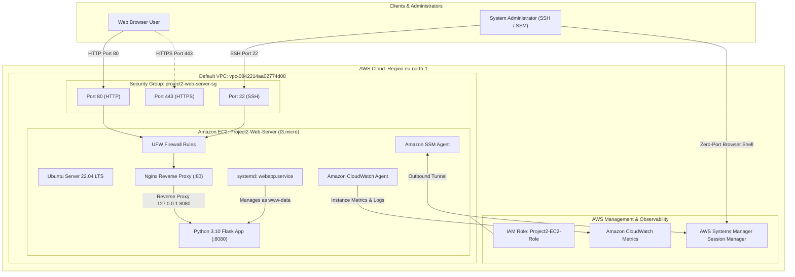

---

## 4. Technologies and AWS Services

| Category | Technology / Service | Version / Specification | Description & Role |
| :--- | :--- | :--- | :--- |
| **Cloud Compute** | **Amazon EC2** | `t3.micro` (Burstable) | High-performance virtual machine hosting the Linux operating system and web server. |
| **Operating System** | **Ubuntu Server** | `22.04 LTS` (Jammy Jellyfish x86_64) | Enterprise-grade Debian-based Linux distribution offering stability and LTS security patches. |
| **Security & Identity** | **AWS IAM** | Custom Instance Profile | Instance profile `Project2-EC2-Role` providing credential-free access to CloudWatch and SSM. |
| **Network Security** | **AWS Security Group** | Stateful Virtual Firewall | Inbound filtering on TCP port 22 (SSH), TCP port 80 (HTTP), and TCP port 443 (HTTPS). |
| **Host Firewall** | **UFW (Uncomplicated Firewall)** | Native Ubuntu package | OS-level firewall ensuring defense-in-depth on ports 22, 80, and 443. |
| **Access Management** | **EC2 Key Pair** | RSA 2048-bit (`project2-key.pem`) | Cryptographic key pair used for secure SSH remote command-line authentication. |
| **Instance Automation** | **EC2 User Data (cloud-init)** | Bash bootstrap script | Shell initialization script executing upon first boot to automate package setup, app configuration, and service launches. |
| **Runtime & Language** | **Python** | Python 3.10 | Core programming runtime executing the web application inside an isolated virtual environment (`/opt/webapp/venv`). |
| **Application Framework** | **Flask** | Version 2.3.3 / Werkzeug 2.3.7 | Lightweight WSGI web framework serving dynamic server health and system information. |
| **Reverse Proxy** | **Nginx** | 1.18+ (Ubuntu stable) | Web server binding to public port 80, proxying client traffic to the internal Flask port 8080. |
| **Process Supervision** | **systemd** | System and Service Manager | Supervises `webapp.service`, auto-restarting the application on failure and isolating execution under `www-data`. |
| **Remote Access** | **AWS Systems Manager (SSM)** | Session Manager | Secure browser-based shell access without requiring public IP access, bastion hosts, or open port 22. |
| **Monitoring & Telemetry** | **Amazon CloudWatch** | CloudWatch Metrics & Agent | Captures real-time compute telemetry: `NetworkIn`, `NetworkOut`, `CPUCreditBalance`, and system status checks. |

---

## 5. Project Directory Structure

```
Project2-Linux Server Setup on EC2/
│
├── Screenshots/                                # Implementation evidence & verification screenshots
│   ├── AWS EC2 Linux Server Architecture.png   # Full AWS architectural diagram
│   ├── 1.png                                   # Step 1: AWS Console Home in Europe (Stockholm)
│   ├── 2.png                                   # Step 2: EC2 Security Group configuration details
│   ├── 3.png                                   # Step 3: IAM Role creation confirmation (Project2-EC2-Role)
│   ├── 4.png                                   # Step 4: EC2 Key Pair generation confirmation (project2-key)
│   ├── 5.png                                   # Step 5: EC2 Running Instance Summary (Project2-Web-Server)
│   ├── 6.png                                   # Step 6: Initial Nginx web server confirmation
│   ├── 7.png                                   # Step 7: Flask Web Application live response
│   ├── 8.png                                   # Step 8: Application JSON health check endpoint verification
│   ├── 9.png                                   # Step 9: EC2 SSH client connection instructions & status checks
│   └── 10.png                                  # Step 10: Amazon CloudWatch live per-instance metrics dashboard
│
├── app.py                                      # Standalone Flask application with health/metrics endpoints
├── requirements.txt                            # Application Python dependency specification
├── user-data.sh                                # Automated EC2 initialization & configuration bootstrap script
├── deploy.sh                                   # Optional AWS CLI automated deployment script (Amazon Linux 2023)
├── cleanup.sh                                  # Optional AWS CLI automated resource teardown script
└── README.md                                   # Comprehensive technical project documentation
```

---

## 6. Prerequisites

Before replicating or deploying this project, verify the following prerequisites:

1. **Active AWS Account**: An active AWS subscription with permissions to manage Amazon EC2, IAM, Security Groups, and CloudWatch.
2. **AWS Management Console Access**: Authenticated administrative or PowerUser IAM credentials.
3. **Target AWS Region**: Deployed in **Europe (Stockholm) `eu-north-1`** (or your preferred region with default VPC support).
4. **VPC Networking**: A default VPC with an attached Internet Gateway and public subnets configured to auto-assign public IPv4 addresses.
5. **Local Tools & Knowledge**:
   - Modern web browser (Chrome, Firefox, Edge, Safari).
   - Basic familiarity with Linux terminal commands (`systemctl`, `journalctl`, `apt`, `curl`, `chmod`).
   - SSH Client (OpenSSH on Linux/macOS/Windows PowerShell) or AWS Systems Manager Session Manager.
6. **Project Repository Files**: Ensure `user-data.sh`, `app.py`, and `requirements.txt` are available locally.

---

## 7. Implementation – Step by Step

### Step 1: Navigating to the AWS Management Console

Log into the AWS Management Console and ensure your active region is set to **Europe (Stockholm) `eu-north-1`**. The console provides a centralized dashboard to access compute, network, identity, and observability services.

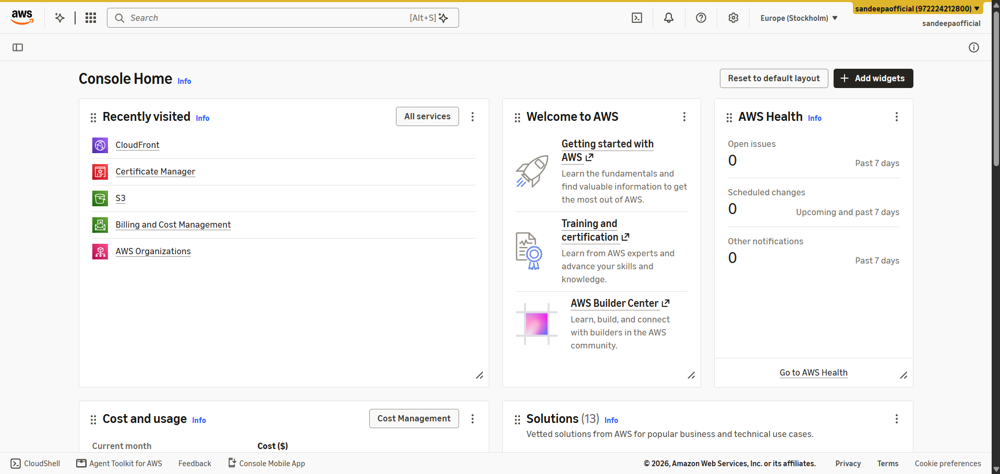
*Figure 7.1: The AWS Management Console Home interface in the Europe (Stockholm) region before launching compute resources.*

---

### Step 2: Creating and Configuring the EC2 Security Group

A security group acts as a virtual stateful firewall controlling inbound and outbound network traffic to the EC2 instance.

1. In the AWS Management Console, navigate to **EC2** > **Network & Security** > **Security Groups**.
2. Click **Create security group**.
3. Configure the basic details:
   - **Security group name**: `project2-web-server-sg`
   - **Description**: `Security group for Project 2 EC2 web server`
   - **VPC**: Default VPC (`vpc-0842214aa02774d08`)
4. Configure **Inbound Rules**:
   - **Rule 1 (SSH)**: Type `SSH`, Protocol `TCP`, Port `22`, Source `My IP` (or `0.0.0.0/0` during initial staging).
   - **Rule 2 (HTTP)**: Type `HTTP`, Protocol `TCP`, Port `80`, Source `0.0.0.0/0` (Anywhere IPv4).
   - **Rule 3 (HTTPS)**: Type `HTTPS`, Protocol `TCP`, Port `443`, Source `0.0.0.0/0` (Anywhere IPv4).
5. Verify **Outbound Rules**:
   - Keep default: Type `All traffic`, Protocol `All`, Port range `All`, Destination `0.0.0.0/0`.
6. Click **Create security group**.

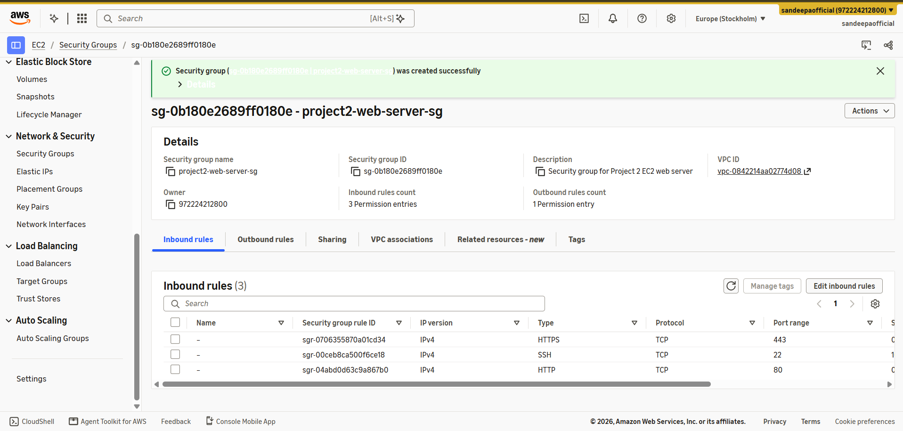
*Figure 7.2: Security group `project2-web-server-sg` (ID: `sg-0b180e2689ff0180e`) successfully provisioned with three inbound rules: SSH (22), HTTP (80), and HTTPS (443).*

---

### Step 3: Creating the IAM Role and Attaching Policies

Rather than embedding long-lived AWS IAM access keys within the server, an IAM role is attached directly to the EC2 instance metadata profile.

1. Navigate to the **IAM Console** > **Roles** > **Create role**.
2. Select **AWS service** as the Trusted Entity type and choose **EC2** as the common use case.
3. Attach the following AWS-managed policies:
   - `CloudWatchAgentServerPolicy`: Grants permissions to send server telemetry, memory metrics, and log events to Amazon CloudWatch.
   - `AmazonSSMManagedInstanceCore`: Grants permissions required for the AWS Systems Manager service to establish a secure Session Manager shell.
4. Name the role `Project2-EC2-Role`.
5. Review the trust relationship allowing `ec2.amazonaws.com` to call `sts:AssumeRole` and click **Create role**.

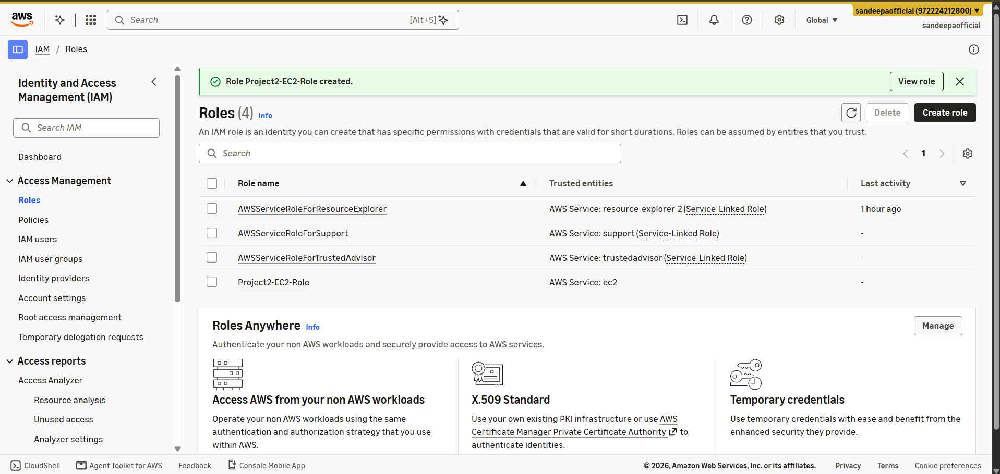
*Figure 7.3: The IAM Roles console confirming the successful creation of `Project2-EC2-Role` with `AWS Service: ec2` as the trusted entity.*

---

### Step 4: Generating an EC2 Key Pair

To enable SSH access for remote management, generate an RSA key pair:

1. Navigate to **EC2 Console** > **Network & Security** > **Key Pairs**.
2. Click **Create key pair**.
3. Specify:
   - **Name**: `project2-key`
   - **Key pair type**: `RSA`
   - **Private key file format**: `.pem` (for OpenSSH, Linux, macOS, and Windows PowerShell)
4. Click **Create key pair**.
5. Save `project2-key.pem` to your local machine (e.g., project root) and secure file permissions.

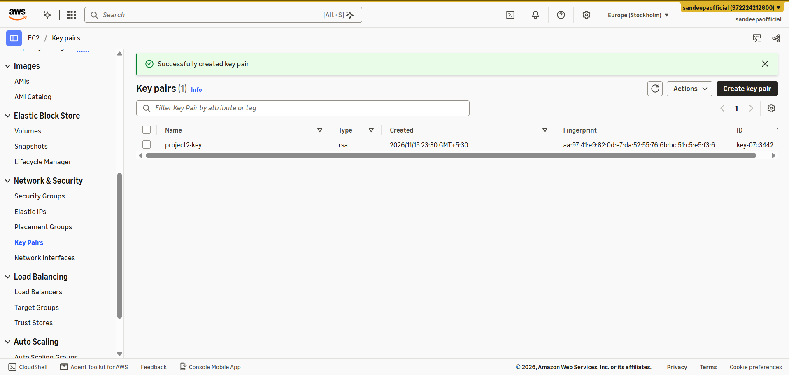
*Figure 7.4: EC2 Key Pairs dashboard displaying `project2-key` created with RSA algorithm and associated cryptographic fingerprint.*

---

### Step 5: Launching the Ubuntu 22.04 LTS EC2 Instance

Launch the server with the configured networking, identity, and compute settings:

1. In the **EC2 Dashboard**, click **Launch instance**.
2. Configure instance parameters:
   - **Name and tags**: `Project2-Web-Server`
   - **Application and OS Images (AMI)**: **Ubuntu Server 22.04 LTS (HVM), SSD Volume Type** (64-bit x86).
   - **Instance type**: `t3.micro` (2 vCPU, 1 GiB Memory).
   - **Key pair (login)**: Select `project2-key`.
   - **Network settings**:
     - VPC: Default VPC.
     - Auto-assign Public IP: `Enable`.
     - Firewall (security groups): Select existing security group `project2-web-server-sg`.
   - **Configure storage**: 8 GiB gp3 General Purpose SSD.

---

### Step 6: User Data Automated Bootstrap Configuration

Under **Advanced details**, attach the IAM profile and bootstrap the server using cloud-init User Data:

1. **IAM instance profile**: Select `Project2-EC2-Role`.
2. **Metadata options**:
   - HTTP tokens: `Required` (Enforces IMDSv2).
3. **User data**: Paste the contents of `user-data.sh`:

```bash
#!/bin/bash
# System update and toolchain installation
apt-get update
apt-get upgrade -y
apt-get install -y curl wget git python3 python3-pip python3-venv ufw htop net-tools unattended-upgrades nginx

# Set up application directory and virtual environment
mkdir -p /opt/webapp
cd /opt/webapp
python3 -m venv venv
source venv/bin/activate
pip install --upgrade pip
pip install Flask==2.3.3 Werkzeug==2.3.7

# Write the Flask application code
cat > app.py << 'APPEOF'
from flask import Flask, render_template_string
import socket
from datetime import datetime

app = Flask(__name__)

HTML_TEMPLATE = """
<!DOCTYPE html>
<html>
<head>
    <title>EC2 Server Application</title>
    <style>
        body { font-family: Arial, sans-serif; max-width: 800px; margin: 50px auto; padding: 20px; background: linear-gradient(135deg, #667eea 0%, #764ba2 100%); min-height: 100vh; }
        .container { background: white; border-radius: 10px; padding: 30px; box-shadow: 0 10px 25px rgba(0,0,0,0.2); }
        h1 { color: #333; border-bottom: 3px solid #667eea; padding-bottom: 10px; }
        .info-box { background: #f0f4ff; border-left: 4px solid #667eea; padding: 15px; margin: 15px 0; border-radius: 5px; }
        .label { font-weight: bold; color: #667eea; }
        .status { color: #28a745; font-weight: bold; }
    </style>
</head>
<body>
    <div class="container">
        <h1>✅ EC2 Linux Server is Running</h1>
        <div class="info-box">
            <p><span class="label">Server Status:</span> <span class="status">HEALTHY</span></p>
            <p><span class="label">Server Name:</span> {{ hostname }}</p>
            <p><span class="label">Server IP:</span> {{ ip_address }}</p>
            <p><span class="label">Current Time:</span> {{ current_time }}</p>
        </div>
    </div>
</body>
</html>
"""

@app.route('/')
def home():
    hostname = socket.gethostname()
    ip_address = socket.gethostbyname(hostname)
    current_time = datetime.now().strftime('%Y-%m-%d %H:%M:%S UTC')
    return render_template_string(HTML_TEMPLATE, hostname=hostname, ip_address=ip_address, current_time=current_time)

@app.route('/health')
def health():
    return {'status': 'healthy'}, 200

if __name__ == '__main__':
    app.run(host='0.0.0.0', port=8080, debug=False)
APPEOF

# Configure Nginx reverse proxy on port 80 to redirect to port 8080
cat > /etc/nginx/sites-available/webapp << 'NGINXEOF'
server {
    listen 80;
    server_name _;

    location / {
        proxy_pass http://127.0.0.1:8080;
        proxy_set_header Host $host;
        proxy_set_header X-Real-IP $remote_addr;
        proxy_set_header X-Forwarded-For $proxy_add_x_forwarded_for;
    }

    location /health {
        proxy_pass http://127.0.0.1:8080/health;
    }
}
NGINXEOF

ln -sf /etc/nginx/sites-available/webapp /etc/nginx/sites-enabled/webapp
rm -f /etc/nginx/sites-enabled/default
systemctl enable nginx
systemctl start nginx

# Configure systemd daemon to run webapp under www-data user
cat > /etc/systemd/system/webapp.service << 'SERVICEEOF'
[Unit]
Description=Flask Web Application
After=network.target

[Service]
Type=simple
User=www-data
WorkingDirectory=/opt/webapp
ExecStart=/opt/webapp/venv/bin/python app.py
Restart=always
RestartSec=10

[Install]
WantedBy=multi-user.target
SERVICEEOF

chown -R www-data:www-data /opt/webapp
chmod 755 /opt/webapp
systemctl daemon-reload
systemctl enable webapp.service
systemctl start webapp.service

# Configure UFW Host Firewall
ufw --force enable
ufw allow 22/tcp
ufw allow 80/tcp
ufw allow 443/tcp

# Install CloudWatch agent package
wget -q https://s3.amazonaws.com/amazoncloudwatch-agent/ubuntu/amd64/latest/amazon-cloudwatch-agent.deb
dpkg -i -E ./amazon-cloudwatch-agent.deb || true
rm -f amazon-cloudwatch-agent.deb

# Enable unattended security upgrades
systemctl enable unattended-upgrades
systemctl start unattended-upgrades

echo "EC2 Setup Complete: $(date)" >> /var/log/setup.log
```

4. Click **Launch instance**.

---

### Step 7: Monitoring Instance Status & Initialization

After triggering the launch, monitor the EC2 dashboard until the instance is fully initialized:

- **Instance State**: `Running`
- **Public IPv4 Address**: Note the assigned public IP (`16.171.147.42` / `13.51.206.4`)
- **Status Checks**: System and instance reachability checks passing (`2/2 checks passed` or `3/3 checks passed`).

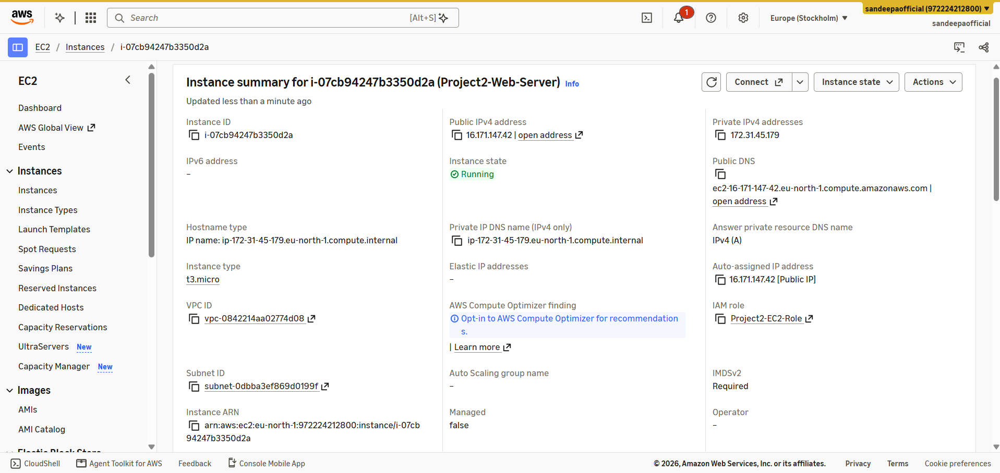
*Figure 7.5: EC2 Instance Summary for `Project2-Web-Server` (`i-07cb94247b3350d2a`) showing Running state, t3.micro type, public IP `16.171.147.42`, private IP `172.31.45.179`, and IAM role `Project2-EC2-Role`.*

---

### Step 8: Accessing the Application & Reverse Proxy Verification

During the startup phase, Nginx initializes and briefly serves its default landing page until the `user-data.sh` script completes virtual environment creation, configures the reverse proxy site, and starts the `webapp.service`.

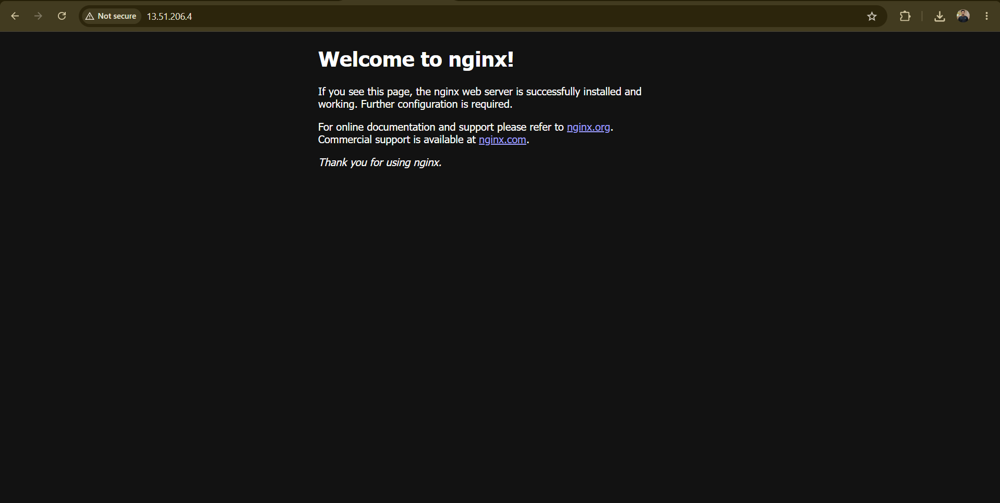
*Figure 7.6: Initial HTTP response on port 80 showing Nginx web server online before the reverse proxy configuration points traffic to the internal Flask application.*

Once the bootstrap script finalizes, visiting `http://<PUBLIC_IP>` renders the hardened Flask server status dashboard:

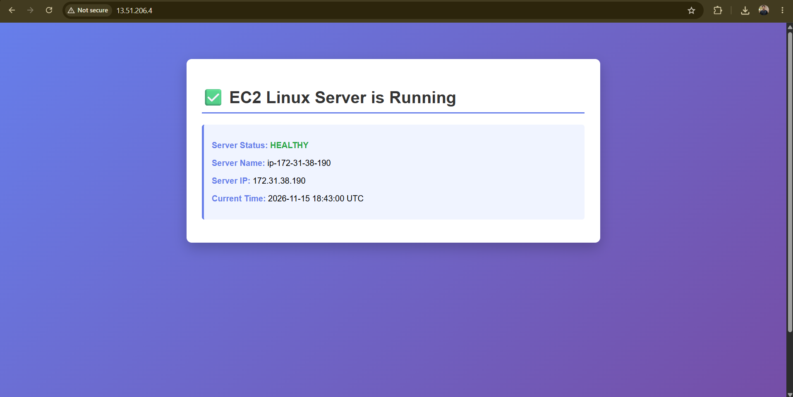
*Figure 7.7: Production web response showing the Python Flask application rendering "✅ EC2 Linux Server is Running", Server Status "HEALTHY", Private Hostname `ip-172-31-38-190`, and UTC timestamp.*

---

### Step 9: Testing the Health Check Endpoint

Automated infrastructure, Application Load Balancers (ALBs), and external synthetic probes rely on dedicated lightweight health check endpoints.

Navigate to `http://<PUBLIC_IP>/health` in a browser or test via curl:

```bash
curl -i http://<PUBLIC_IP>/health
```

Expected HTTP Response:
```http
HTTP/1.1 200 OK
Server: nginx/1.18.0 (Ubuntu)
Date: Sun, 15 Nov 2026 18:43:55 GMT
Content-Type: application/json
Content-Length: 20
Connection: keep-alive

{
  "status": "healthy"
}
```

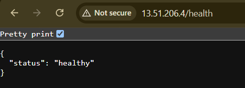
*Figure 7.8: Clean JSON response `{"status": "healthy"}` returned by the Flask `/health` route through Nginx reverse proxy.*

---

### Step 10: Secure Connection & Validation via SSH / Session Manager

AWS provides multiple methods to securely connect to the running instance:

#### Method A: SSH Key-Based Connection

1. Set the appropriate private key permissions locally:
   ```bash
   chmod 400 project2-key.pem
   ```
2. Connect using the `ubuntu` default user account:
   ```bash
   ssh -i project2-key.pem ubuntu@<PUBLIC_IP>
   ```

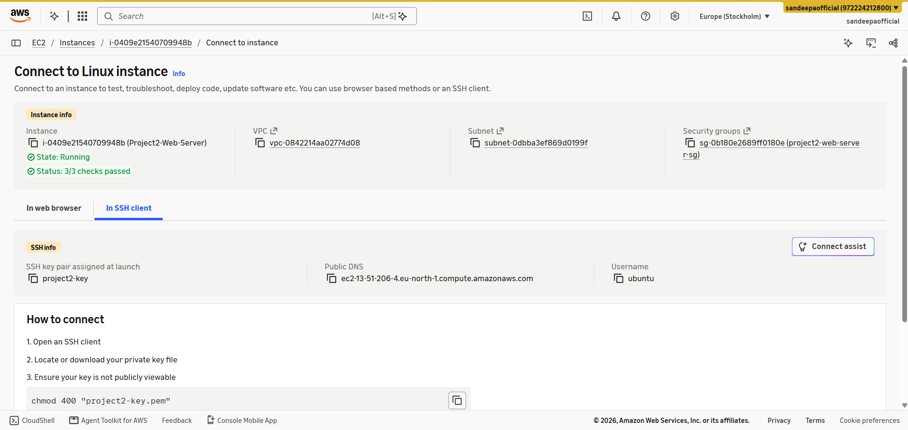
*Figure 7.9: The EC2 Connect dialog displaying `Project2-Web-Server` with 3/3 status checks passed, assigned key `project2-key`, public DNS `ec2-13-51-206-4.eu-north-1.compute.amazonaws.com`, and SSH command instructions.*

#### Method B: AWS Systems Manager Session Manager

Thanks to the attached IAM policy `AmazonSSMManagedInstanceCore` and pre-installed SSM agent in Ubuntu 22.04 LTS:
1. Select the instance in the EC2 Console.
2. Click **Connect** > select **Session Manager** tab.
3. Click **Connect** to launch an interactive bash shell in your browser with no open inbound SSH port 22 required!

---

### Step 11: Real-Time Infrastructure Monitoring in Amazon CloudWatch

Navigate to **CloudWatch** > **Metrics** > **All** > **EC2** > **Per-Instance Metrics** and select `Project2-Web-Server`.

Metrics tracked in real-time include:
- `NetworkIn` & `NetworkOut` (bytes transferred)
- `NetworkPacketsIn` & `NetworkPacketsOut`
- `CPUCreditBalance` & `CPUCreditUsage`
- `StatusCheckFailed_Instance` & `StatusCheckFailed_System`

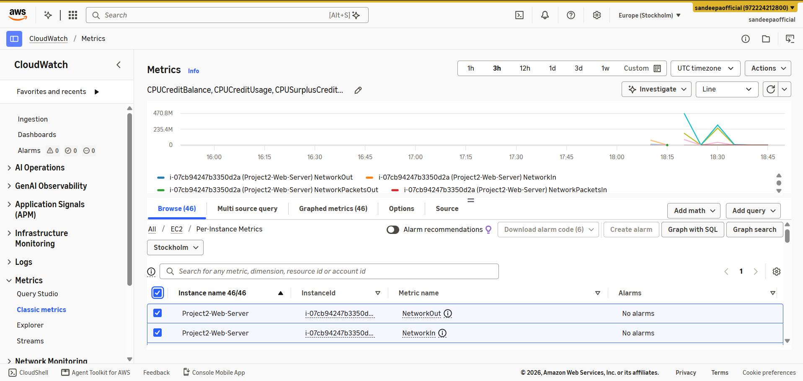
*Figure 7.10: Amazon CloudWatch console displaying real-time metrics telemetry (`NetworkOut`, `NetworkIn`, `NetworkPacketsOut`, `NetworkPacketsIn`, `CPUCreditBalance`) for `Project2-Web-Server`.*

---

## 8. Screenshots and Implementation Evidence

The repository includes captured screenshots documenting each phase of the project:

| Screenshot | File Path | Phase / Step | Detailed Description |
| :--- | :--- | :--- | :--- |
| **System Architecture** | [`Screenshots/AWS EC2 Linux Server Architecture.png`](Screenshots/AWS%20EC2%20Linux%20Server%20Architecture.png) | Architecture & Design | Complete architectural diagram illustrating VPC, Security Groups, EC2 instance with Ubuntu/Nginx/Flask, IAM Role, SSM, and CloudWatch. |
| **Console Entry Point** | [`Screenshots/1.png`](Screenshots/1.png) | Step 1: Console Setup | AWS Console Home in the `eu-north-1` (Stockholm) region before resource provisioning. |
| **Security Group** | [`Screenshots/2.png`](Screenshots/2.png) | Step 2: Network Perimeter | Verified Security Group `project2-web-server-sg` (`sg-0b180e2689ff0180e`) with inbound TCP rules for SSH (22), HTTP (80), and HTTPS (443). |
| **IAM Role & Policies** | [`Screenshots/3.png`](Screenshots/3.png) | Step 3: Identity & IAM | IAM Roles list confirming `Project2-EC2-Role` provisioned with trust entity `AWS Service: ec2`. |
| **Key Pair Generation** | [`Screenshots/4.png`](Screenshots/4.png) | Step 4: Cryptographic Keys | Successful generation of RSA key pair `project2-key` for secure server shell authentication. |
| **Instance Provisioning** | [`Screenshots/5.png`](Screenshots/5.png) | Step 5: Compute Launch | Running instance summary for `Project2-Web-Server` (`i-07cb94247b3350d2a`, `t3.micro`, IP `16.171.147.42`, IAM Profile attached). |
| **Nginx Initial State** | [`Screenshots/6.png`](Screenshots/6.png) | Step 8: Web Tier Setup | Nginx landing page confirming the reverse proxy daemon is active and listening on public port 80. |
| **Flask Application** | [`Screenshots/7.png`](Screenshots/7.png) | Step 8: App Verification | Live web response from the Python Flask app displaying `HEALTHY` server status, private hostname, and current UTC time. |
| **Health API Route** | [`Screenshots/8.png`](Screenshots/8.png) | Step 9: Health Validation | Dedicated JSON health endpoint `http://<PUBLIC_IP>/health` returning valid HTTP 200 `{"status": "healthy"}`. |
| **Remote Access & Status** | [`Screenshots/9.png`](Screenshots/9.png) | Step 10: Connectivity | EC2 Connect dialog for `Project2-Web-Server` showing passed status checks, public DNS, and SSH login parameters. |
| **Observability Telemetry** | [`Screenshots/10.png`](Screenshots/10.png) | Step 11: CloudWatch Monitoring | CloudWatch per-instance metrics graph displaying real-time network traffic throughput and CPU credit utilization. |

---

## 9. Application Testing and Validation

Comprehensive verification was conducted to validate server performance, security hardening, and application integrity:

### 1. HTTP Web Access Verification
Open `http://<PUBLIC_IP>` in any web browser.
- **Expected UI**: Gradient purple header reading *"✅ EC2 Linux Server is Running"*.
- **Payload Verification**: Dynamic host information (`ip-172-31-38-190`) and real-time server timestamps confirmed.

### 2. Automated Endpoint Testing via CLI
Execute from a local terminal or within the instance:

```bash
# Test the root endpoint
curl -s http://<PUBLIC_IP> | grep -o "EC2 Linux Server is Running"
# Expected: EC2 Linux Server is Running

# Test the health probe endpoint
curl -s -w "\nHTTP Status: %{http_code}\n" http://<PUBLIC_IP>/health
# Expected:
# {"status":"healthy"}
# HTTP Status: 200
```

### 3. Server Systemd & Service Validation
Inside the EC2 instance (via SSH or Session Manager):

```bash
# Check Flask application systemd service
sudo systemctl status webapp.service --no-pager

# Check Nginx status
sudo systemctl status nginx --no-pager

# Verify listening network ports
sudo netstat -tlpn
```

Expected port binding output:
- `tcp 0.0.0.0:80` (nginx: master process)
- `tcp 0.0.0.0:8080` (python: app.py)
- `tcp 0.0.0.0:22` (sshd)

### 4. Verification of Host Firewall (UFW)
```bash
sudo ufw status verbose
```
Expected output:
```text
Status: active
Logging: on (low)
Default: deny (incoming), allow (outgoing), disabled (routed)
New profiles: skip

To                         Action      From
--                         ------      ----
22/tcp                     ALLOW IN    Anywhere
80/tcp                     ALLOW IN    Anywhere
443/tcp                    ALLOW IN    Anywhere
22/tcp (v6)                ALLOW IN    Anywhere (v6)
80/tcp (v6)                ALLOW IN    Anywhere (v6)
443/tcp (v6)               ALLOW IN    Anywhere (v6)
```

### 5. Automated Bootstrap Log Verification
Review the cloud-init bootstrap and user-data execution logs:
```bash
# Check cloud-init execution summary
cat /var/log/cloud-init-output.log | tail -n 25

# Check custom setup completion log
cat /var/log/setup.log
# Expected: EC2 Setup Complete: Sun Nov 15 18:42:30 UTC 2026
```

---

## 10. Security Best Practices

| Control Area | Implemented in This Project | Recommended Production Enhancement |
| :--- | :--- | :--- |
| **Inbound Network Exposure** | Stateful Security Group and host UFW restricted strictly to ports 22, 80, and 443. | Restrict SSH (port 22) to specific corporate VPN or workstation IP CIDR (`/32`), or disable port 22 completely in favor of AWS Systems Manager Session Manager. |
| **Identity & Access Management** | IAM Instance Profile (`Project2-EC2-Role`) provides temporary, rotating STS credentials. Zero long-lived AWS keys stored on disk. | Enforce IAM permission boundaries, least-privilege scoping to specific S3 buckets/CloudWatch namespaces. |
| **SSH Key Protection** | RSA private key (`.pem`) stored locally with restricted read-only permissions (`chmod 400`). | Implement AWS Systems Manager Session Manager with AWS IAM MFA and session logging to Amazon S3/CloudWatch Logs. |
| **Process Privilege Separation** | Flask runs under unprivileged service user `www-data` on internal port 8080, reverse-proxied by Nginx on port 80. | Implement Docker containerization or systemd security hardening sandboxing flags (`ProtectSystem=strict`, `NoNewPrivileges=true`). |
| **Metadata Protection (IMDS)** | Enforced **IMDSv2** (`HttpTokens=required`) on instance launch to prevent SSRF credential theft. | Maintain IMDSv2 enforcement across all account launch templates and SCPs (Service Control Policies). |
| **System Patch Management** | Configured `unattended-upgrades` to automatically install critical security patches on Ubuntu. | Integrate with AWS Systems Manager Patch Manager for enterprise patch baselining and maintenance windows. |
| **Encryption in Transit** | Port 80 HTTP reverse proxy configured with preparation for HTTPS (Port 443 opened in Security Group). | Terminate TLS on an AWS Application Load Balancer (ALB) using AWS Certificate Manager (ACM) or install Let's Encrypt Certbot directly. |
| **Monitoring & Telemetry** | CloudWatch agent debian package installed and per-instance metrics actively tracked in CloudWatch. | Create CloudWatch Alarms for CPU > 80%, status check failures, and set up Amazon SNS email/Slack alerts. |

---

## 11. Troubleshooting Guide

### 1. EC2 Instance Status Check Failures (1/2 or 0/2 passed)
- **Symptom**: Console indicates system check or instance check failed.
- **Root Cause**: Underlying AWS hypervisor host hardware degradation or OS kernel panic/networking stall.
- **Solution**:
  1. In EC2 Console, select the instance and click **Actions** > **Monitor and troubleshoot** > **Get system log** or **Get instance screenshot**.
  2. If the hypervisor failed, perform a **Stop** and then **Start** action on the instance to migrate it to healthy physical host hardware.

### 2. Web Application Does Not Load (`ERR_CONNECTION_TIMED_OUT`)
- **Symptom**: Browser times out when attempting to reach `http://<PUBLIC_IP>`.
- **Root Cause**: Security Group inbound rule missing port 80, or instance lacks an attached Internet Gateway / public IP.
- **Solution**:
  1. Inspect the EC2 Security Group inbound rules and ensure `TCP Port 80` allows `0.0.0.0/0`.
  2. Verify the instance is launched in a public subnet having an active route to an Internet Gateway (`0.0.0.0/0 -> igw-xxxx`).
  3. Ensure UFW allows HTTP: `sudo ufw status`.

### 3. HTTP 502 Bad Gateway Error
- **Symptom**: Nginx responds with `502 Bad Gateway`.
- **Root Cause**: Nginx is running on port 80, but the upstream Flask application on port 8080 is stopped or crashed.
- **Solution**:
  1. Inspect the Flask systemd service status: `sudo systemctl status webapp.service`.
  2. Check application error logs: `sudo journalctl -u webapp.service -n 50 --no-pager`.
  3. Verify Python dependencies exist in the virtual environment: `/opt/webapp/venv/bin/pip list`.
  4. Restart the web service: `sudo systemctl restart webapp.service`.

### 4. User Data Script Failed to Execute
- **Symptom**: The instance boots, but neither Nginx nor the Flask application is installed.
- **Root Cause**: Syntax error, package manager lock, or lack of internet connectivity during boot.
- **Solution**:
  1. Connect via Session Manager or SSH.
  2. Read the full cloud-init execution log:
     ```bash
     sudo cat /var/log/cloud-init-output.log
     ```
  3. Look for errors such as `Unable to locate package` or `Could not get lock /var/lib/dpkg/lock-frontend`.

### 5. SSH Permission Denied (`Permissions 0644 are too open`)
- **Symptom**: SSH refuses connection with `UNPROTECTED PRIVATE KEY FILE!`.
- **Root Cause**: Local permissions on the `.pem` file are too permissive for OpenSSH.
- **Solution**:
  ```bash
  # On Linux / macOS / WSL
  chmod 400 project2-key.pem

  # On Windows PowerShell
  icacls.exe project2-key.pem /reset
  icacls.exe project2-key.pem /grant:r "$($env:USERNAME):(R)"
  icacls.exe project2-key.pem /inheritance:r
  ```

### 6. Cannot Connect via AWS Systems Manager Session Manager
- **Symptom**: Connect button for Session Manager is disabled or displays an SSM error.
- **Root Cause**: Missing IAM policy `AmazonSSMManagedInstanceCore`, or instance lacks outbound internet access to SSM endpoints.
- **Solution**:
  1. Ensure the IAM Role `Project2-EC2-Role` is attached to the instance profile.
  2. Confirm policy `AmazonSSMManagedInstanceCore` is attached.
  3. Confirm the subnet has outbound route table access to the Internet Gateway, or VPC endpoints for SSM are configured.
  4. Wait 3–5 minutes after first launch for the SSM agent daemon to register with the AWS Systems Manager backend.

---

## 12. Cleanup and Cost Management

To prevent ongoing AWS Free Tier consumption or unexpected EC2 compute charges after testing, follow the resource decommissioning procedure:

### Option A: AWS Management Console Decommissioning

1. **Terminate the EC2 Instance**:
   - Open **EC2** > **Instances**.
   - Select `Project2-Web-Server`.
   - Click **Instance state** > **Terminate instance**.
   - Confirm termination. (The attached EBS root volume is automatically deleted).
2. **Delete Security Group**:
   - Navigate to **EC2** > **Security Groups**.
   - Select `project2-web-server-sg`.
   - Click **Actions** > **Delete security groups** (can only be deleted once instance termination is complete).
3. **Delete Key Pair**:
   - Navigate to **EC2** > **Key Pairs**.
   - Select `project2-key` > **Actions** > **Delete**.
4. **Delete IAM Role & Profile**:
   - Navigate to **IAM** > **Roles**.
   - Search for `Project2-EC2-Role` > click **Delete**.
5. **Local File Cleanup**:
   - Securely delete the local private key file `project2-key.pem` if no longer required.

---

## 13. Optional AWS CLI Automation

The repository includes optional shell scripts (`deploy.sh` and `cleanup.sh`) demonstrating automated infrastructure provisioning using the AWS Command Line Interface (CLI).

> [!NOTE]
> **Key Architecture Differences: Console Deployment vs. CLI Automation Script**
>
> | Dimension | Console Deployment (Primary Project) | AWS CLI Script (`deploy.sh`) |
> | :--- | :--- | :--- |
> | **Operating System** | **Ubuntu Server 22.04 LTS** | **Amazon Linux 2023 (AL2023)** |
> | **Package Manager** | `apt-get` / `dpkg` | `yum` / `dnf` |
> | **Default SSH User** | `ubuntu` | `ec2-user` |
> | **Web Application Stack** | Python 3.10 Flask (`app.py`), virtual environment, reverse-proxied by Nginx | Static Nginx HTML web page querying IMDSv2 metadata |
> | **IAM Role Name** | `Project2-EC2-Role` | `WebServerRole` (`WebServerProfile`) |
> | **Security Group Name** | `project2-web-server-sg` | `web-server-sg` |
> | **Key Pair Name** | `project2-key` | `web-server-key` |

### Running the CLI Automation

```bash
# Make the deployment script executable
chmod +x deploy.sh

# Execute deployment
./deploy.sh
```

### Running the Automated Cleanup

```bash
# Make the cleanup script executable
chmod +x cleanup.sh

# Execute cleanup
./cleanup.sh
```

---

## 14. Learning Outcomes

By designing, provisioning, hardening, and validating this project, the following cloud engineering skills were acquired:

- **Compute Provisioning**: Launching and sizing Amazon EC2 instances with appropriate AMIs, instance generations, and EBS storage.
- **Infrastructure as Code / Bootstrapping**: Automating server provisioning via EC2 User Data and cloud-init, eliminating manual configuration drift.
- **Cloud Network Perimeter Security**: Implementing layered defense architectures with stateful AWS Security Groups and host-level UFW firewalls.
- **IAM Instance Profiles**: Eliminating static cloud credentials on virtual machines by leveraging AWS IAM roles, instance profiles, and short-lived STS tokens.
- **Linux Systems Administration**: Managing Linux users, file permissions (`chmod 400`), systemd service daemon lifecycles, and environment isolation.
- **Production Web Tier Design**: Configuring Nginx as a reverse proxy to isolate backend application ports and terminate external traffic.
- **Cloud Observability**: Configuring and analyzing real-time server telemetry using Amazon CloudWatch metrics.
- **Zero-Trust Remote Management**: Utilizing AWS Systems Manager Session Manager for credential-less, browser-based administrative access.

---

## 15. Author

**Sandeepa Wimalasiri**  
*Cloud & DevOps Engineer*

- **GitHub**: [github.com/Sandeepa-git](https://github.com/Sandeepa-git)
- **LinkedIn**: [linkedin.com/in/sandeepa-wimalasiri](https://linkedin.com/in/sandeepa-wimalasiri/)
- **Portfolio**: [sandeepa.online](https://sandeepa.online/)

---
*Developed as part of the AWS Cloud Engineering Project Series.*
